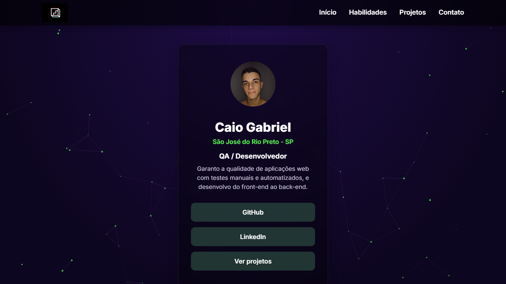
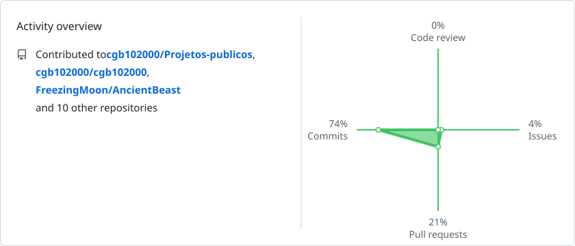

  

---

## 🌐 Meu portfólio

  

Apresentação, habilidades, projetos e contato em um só lugar

---

## 🚀 Sobre mim

🧪 **Analista de QA** na Consumer: testes funcionais, de regressão, de API e mobile, com roteiro de testes e evidências por entrega no Azure DevOps

🔎 Investigação de erros em produção com logs no Kibana/Elastic

🤖 Automação de testes com **Robot Framework** e **Playwright**

💻 Base em desenvolvimento (JavaScript, Node.js, MongoDB) e automações com n8n e IA

---

## 🧪 Quality Assurance

| Área | Atividades |
|---|---|
| **Testes funcionais** | Validação de regras de negócio, fluxos completos e cenários de borda |
| **Testes de API** | Collections e environments no Postman e no Bruno, asserções de status, corpo e tempo de resposta |
| **Regressão & Smoke** | Checagem a cada build para garantir que o que funcionava continua funcionando |
| **Testes mobile** | Validação de apps Android com builds de teste e ambiente local |
| **Bugs & Documentação** | Casos de teste, passos de reprodução e evidências claras para o time |

---

## 📂 Projetos

### 🧪 Qualidade e testes

| Projeto | Descrição | Links |
|---|---|---|
| **Teste automatizado MenuDino** | Testes E2E do fluxo de endereço por CEP, com cenários positivo e negativo, Page Object, screenshot em falha e CI no GitHub Actions. Robot Framework + Playwright. | [Repositório](https://github.com/cgb102000/teste-automatizado-menudino) |
| **Triagem de Issues** | GitHub Action publicada no Marketplace que faz o primeiro filtro de QA nas issues: pede passos para reproduzir, versão e resultado esperado x obtido quando faltam, e coloca um rótulo que sai sozinho quando a issue é completada. | 🛒 [Marketplace](https://github.com/marketplace/actions/triagem-de-issues) · [Código](https://github.com/cgb102000/triagem-issues) |

### 💻 Aplicações web

| Projeto | Descrição | Links |
|---|---|---|
| **Portfólio** | Meu site pessoal: apresentação, habilidades, projetos e contato, com menu para celular e fundo de partículas. HTML, CSS e JavaScript puro. | 🌐 [Acessar](https://cgb102000.github.io/Projetos-publicos/Portifolio/) · [Código](https://github.com/cgb102000/Projetos-publicos/tree/main/Portifolio) |
| **Faturô** | Sistema de gestão para pequenos negócios: caixa, mesas com QR Code, estoque, equipe com permissões, dashboard com DRE e dicas geradas por IA. React, Node.js, MongoDB. | 🌐 [Acessar](https://faturo-frontend.vercel.app/home) · Repositório privado |
| **Ciclos** | App para acompanhar ciclos de medicamentos: calendário, doses, lembretes no Telegram e controle de estoque. PWA instalável. Node.js, PostgreSQL, Prisma. | Repositório privado |
| **VOLT Fitness** | App de treinos com rotina semanal, execução marcando as séries de cada exercício e painel de progresso com sequência de dias e histórico. Login com Google. Lovable. | 🌐 [Acessar](https://voltfitness.lovable.app) · Repositório privado |
| **GeekCore** | Plataforma fullstack de filmes e animes: catálogo, login, perfis, favoritos e comentários. React, Node.js, MongoDB. | 🌐 [Acessar](https://cgb102000.github.io/Projetos-publicos/GeekCore/) · [Código](https://github.com/cgb102000/Projetos-publicos/tree/main/GeekCore) |
| **GeekHub** | Catálogo que consome a API REST do GeekCore: busca, filtros e detalhes. | 🌐 [Acessar](https://cgb102000.github.io/Projetos-publicos/GeekHub/) · [Código](https://github.com/cgb102000/Projetos-publicos/tree/main/GeekHub) |
| **FarmaUnix** | Farmácia online com carrinho, taxa de entrega por distância e mapa da rota (Leaflet). | 🌐 [Acessar](https://cgb102000.github.io/Projetos-publicos/FarmaUnix/src/) · [Código](https://github.com/cgb102000/Projetos-publicos/tree/main/FarmaUnix) |
| **Pokédex** | Busca de Pokémon em tempo real com a PokéAPI. | 🌐 [Acessar](https://cgb102000.github.io/Projetos-publicos/Pokedex/) · [Código](https://github.com/cgb102000/Projetos-publicos/tree/main/Pokedex) |
| **Música para Todos** | Busca de músicas, artistas e álbuns com a Web API do Spotify. | 🌐 [Acessar](https://cgb102000.github.io/Projetos-publicos/Spotify/) · [Código](https://github.com/cgb102000/Projetos-publicos/tree/main/Spotify) |

### 🛠️ Ferramentas

| Projeto | Descrição | Links |
|---|---|---|
| **Radar de Issues** | Encontra issues livres para contribuir em open source: sem dono, sem PR vinculado, com good first issue ou help wanted, por linguagem e repositório. API de busca do GitHub. | 🌐 [Acessar](https://cgb102000.github.io/radar-issues/) · [Código](https://github.com/cgb102000/radar-issues) |
| **Vigia de PRs** | Avisa no Telegram quando alguém comenta, revisa, aprova, integra ou fecha os meus PRs em projetos open source. Roda sozinho no GitHub Actions a cada 15 minutos, com a API do GitHub e testes com `node:test`. | [Código](https://github.com/cgb102000/vigia-prs) |
| **Redimensionar Imagem** | Redimensiona várias imagens no navegador e converte para JPEG, PNG ou WebP. | 🌐 [Acessar](https://cgb102000.github.io/Projetos-publicos/Redimensionar%20Imagem/) · [Código](https://github.com/cgb102000/Projetos-publicos/tree/main/Redimensionar%20Imagem) |
| **Contador de Palavras** | Conta palavras e caracteres de um texto em tempo real. | 🌐 [Acessar](https://cgb102000.github.io/Projetos-publicos/Contador%20de%20caracteres%20e%20palavras/) · [Código](https://github.com/cgb102000/Projetos-publicos/tree/main/Contador%20de%20caracteres%20e%20palavras) |
| **Audio to Text** | Transcrição de áudio com Whisper (OpenAI) rodando localmente. Python + Flask. | [Código](https://github.com/cgb102000/Projetos-publicos/tree/main/Audio%20to%20Text) |

➡️ Todos os projetos: [**Projetos-publicos**](https://github.com/cgb102000/Projetos-publicos)

---

## 🤝 Contribuições open source

| Projeto | O que fiz | Status |
|---|---|---|
| **[AncientBeast](https://github.com/FreezingMoon/AncientBeast)** · jogo de estratégia por turnos | Efeitos visuais, melhorias de interface, sons, controles por mouse e toque, e rótulos automáticos de PR no CI |   |
| **[Ant Design](https://github.com/ant-design/ant-design)** · biblioteca de componentes React | Tradução pt-BR (textos de acessibilidade que faltavam e correções) e QA de PRs e bugs na versão 6, com medições publicadas nas issues | [PR em análise](https://github.com/ant-design/ant-design/pull/60002) |
| **[Bruno](https://github.com/usebruno/bruno)** · cliente de API open source | Botão de copiar do "Generate Code" aparecendo só ao passar o mouse | [PR em análise](https://github.com/usebruno/bruno/pull/9959) |
| **[Flowise](https://github.com/FlowiseAI/Flowise)** · construtor visual de agentes de IA | Menu lateral sincronizado com a rota ao clicar no logo | [PR em análise](https://github.com/FlowiseAI/Flowise/pull/6580) |
| **[task_manager](https://github.com/Navashub/task_manager)** · API de tarefas | Paginação nos endpoints de tarefas e usuários | [Integrado](https://github.com/Navashub/task_manager/pull/18) |

---

## 🛠️ Tech Stack

### QA & Testing

  
  
  
  
  
  

### Linguagens e bancos

  
  
  

### Automação & IA

  
  
  
  

**Modelos open source**

  
  
  
  

### Ferramentas

  

---

## 📊 GitHub Stats

  

<picture>
  <source media="(prefers-color-scheme: dark)" srcset="https://github-readme-stats.vercel.app/api/top-langs/?username=cgb102000&layout=compact&card_width=380&hide_border=true&bg_color=0d1117&title_color=ff0000&text_color=c9d1d9" />
  
</picture>

---

## 📈 Contribution Graph

<picture>
  <source media="(prefers-color-scheme: dark)" srcset="https://raw.githubusercontent.com/cgb102000/cgb102000/output/activity-overview-dark.svg" />
  
</picture>

  

<picture>
  <source media="(prefers-color-scheme: dark)" srcset="https://raw.githubusercontent.com/cgb102000/cgb102000/output/github-contribution-grid-snake-dark.svg" />
  
</picture>

---

## 🌐 Contato

  

